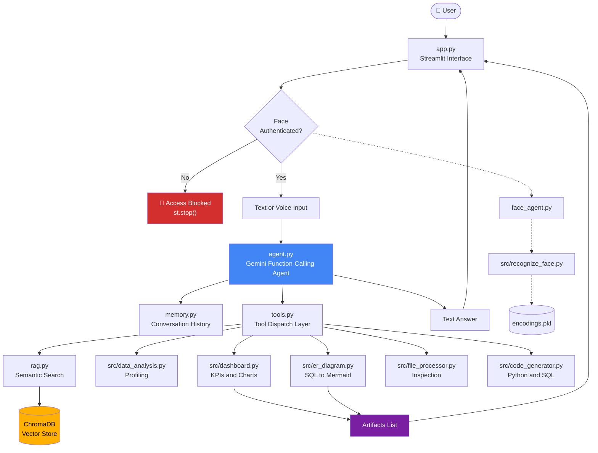
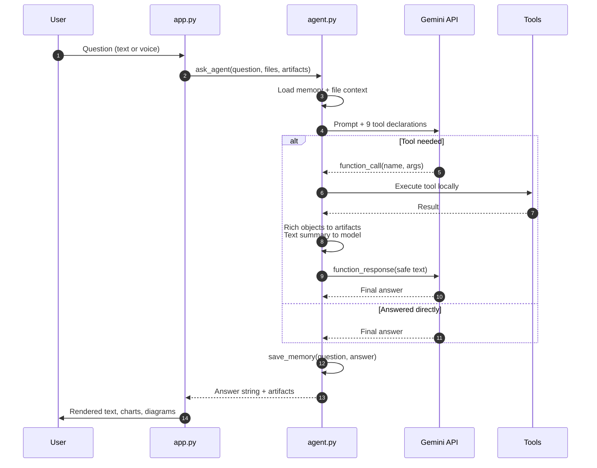
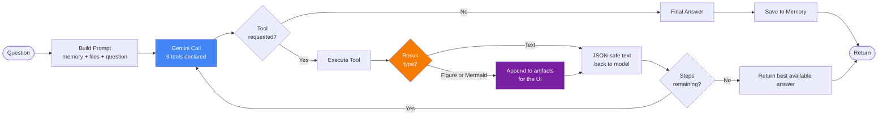
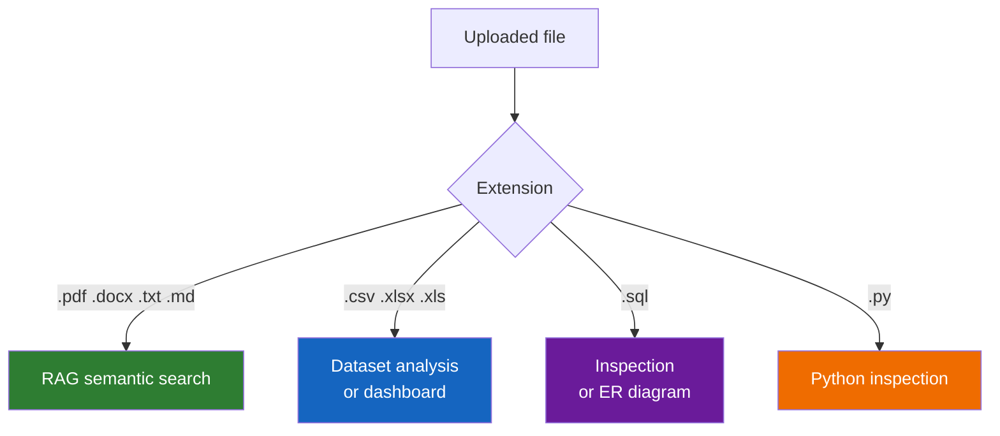
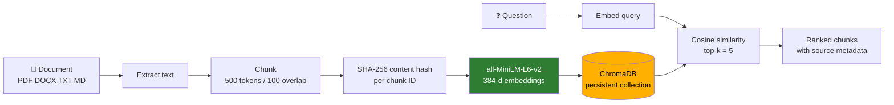
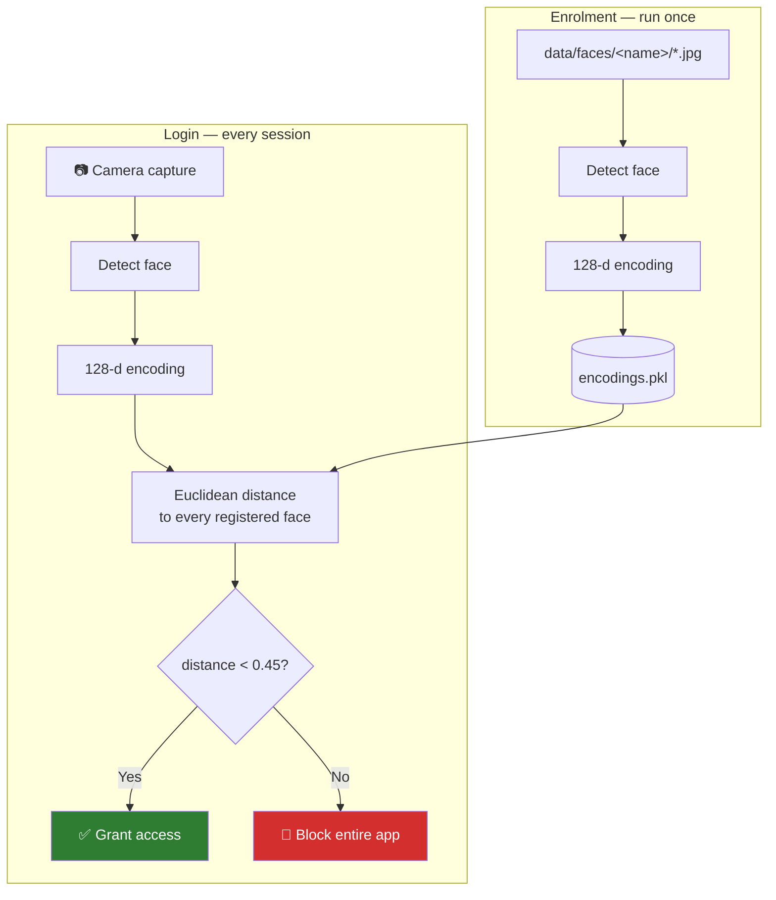
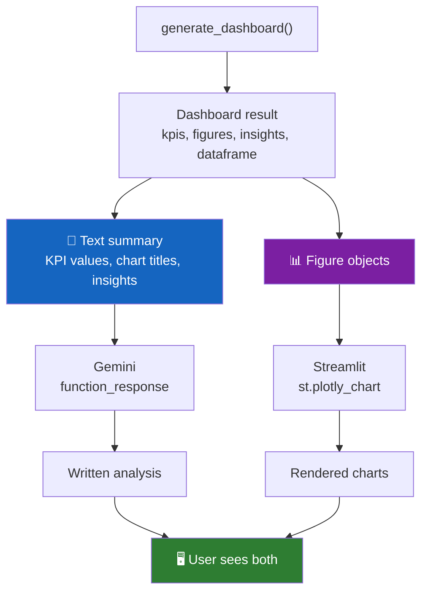

<div align="center">

# 🤖 Multimodal AI Personal Assistant

**A face-authenticated agentic AI system with voice input, document RAG, and nine-tool LLM function calling.**


</div>

---

## 📌 Overview

Most AI chat apps accept a question and return text. This one authenticates you
with your face first, listens if you'd rather speak than type, and then decides
for itself which of nine tools it needs to answer you — semantic search across
your documents, statistical profiling of a spreadsheet, a generated dashboard,
an ER diagram from a SQL schema, or nothing at all if it already knows.

It is roughly **5,400 lines across 18 modules**, built as a single Streamlit
application.

| | |
|---|---|
| **Problem** | Analysts juggle separate tools for document search, data profiling, charting and schema inspection, with no shared context between them. |
| **Approach** | One conversational interface backed by an LLM agent that routes each question to the right tool and keeps the results in context. |
| **Access control** | Biometric. Unknown faces reach nothing — not the chat, not the uploader. |

---

## 📑 Table of Contents

- [Features](#-features)
- [System Architecture](#-system-architecture)
- [Request Lifecycle](#-request-lifecycle)
- [The Agent Tool Loop](#-the-agent-tool-loop)
- [The Nine Tools](#-the-nine-tools)
- [RAG Pipeline](#-rag-pipeline)
- [Face Authentication](#-face-authentication)
- [Design Deep Dive](#-design-deep-dive)
- [Project Structure](#-project-structure)
- [Tech Stack](#-tech-stack)
- [Installation](#-installation)
- [Configuration](#-configuration)
- [Usage](#-usage)
- [Cost and Performance](#-cost-and-performance)
- [Troubleshooting](#-troubleshooting)
- [Known Limitations](#-known-limitations)
- [Roadmap](#-roadmap)
- [Security](#-security)

---

## ✨ Features

| Capability | Implementation |
|---|---|
| 🔐 **Face login** | 128-dimension dlib encodings, matched at a 0.45 distance threshold against a registered gallery |
| 🎤 **Voice input** | Browser audio capture, transcribed via Google Speech Recognition |
| 📚 **Document RAG** | PDF / DOCX / TXT / MD chunked, embedded with `all-MiniLM-L6-v2`, stored in persistent ChromaDB |
| 📊 **Dataset profiling** | Shape, dtypes, missing values, duplicates, descriptive statistics, correlations |
| 📈 **Auto dashboards** | KPI cards, multi-chart Plotly layouts, generated insights — from any CSV or Excel file |
| 🗂️ **ER diagrams** | SQL schema parsed to Mermaid with balanced-parenthesis tokenisation |
| 💻 **Code generation** | Python and SQL from a plain-English requirement |
| 🧠 **Conversation memory** | Rolling history persisted to disk and injected into every prompt |
| 🔁 **Multi-step reasoning** | The agent can chain tools across turns before answering |

---

## 🏗 System Architecture



---

## 🔄 Request Lifecycle

What happens between pressing Send and seeing an answer.



---

## ⚙️ The Agent Tool Loop



The loop is capped at `MAX_TOOL_STEPS` so a model that keeps requesting tools
cannot spin indefinitely.

---

## 🧰 The Nine Tools

| Tool | Triggered by | Returns |
|---|---|---|
| `calculator` | Arithmetic in a question | Result via a safe AST evaluator, no `eval` |
| `search_documents` | Questions about uploaded PDFs, DOCX, TXT, MD | Top-k semantic matches with sources |
| `list_indexed_documents` | "What documents do you have?" | Names in the vector store |
| `index_uploaded_documents` | A document that skipped auto-indexing | Chunk counts per file |
| `inspect_uploaded_file` | "What's in this file?" | Structure summary for any supported type |
| `analyze_uploaded_dataset` | "Analyse this CSV" | Rows, dtypes, missing values, stats, correlations |
| `generate_dashboard` | "Build a dashboard" | KPI cards, charts, insights — rendered, plus a text summary |
| `create_er_diagram` | A `.sql` schema file | Mermaid ER diagram, rendered |
| `generate_python` / `generate_sql` | "Write code that..." | Generated source, never executed |

### Routing rules



Spreadsheets deliberately never go through RAG. Semantic search over tabular
rows returns fragments without the aggregate context a statistical summary
provides.

---

## 📚 RAG Pipeline



**Why content hashing.** Chunk IDs derive from a SHA-256 of the content, so
re-uploading the same document overwrites existing chunks rather than
duplicating them. Without it, uploading a file three times would triple its
weight in every retrieval.

**Why 500/100.** 500 tokens is large enough to hold a complete idea, and the
100-token overlap prevents an answer that straddles a boundary from being cut
in half.

---

## 🔐 Face Authentication



The gate calls `st.stop()`, so an unrecognised user never renders the chat
interface or the file uploader — it is not a cosmetic check.

Enrolment images that contain no face, or more than one, are skipped with a
reported count rather than silently corrupting the gallery.

---

## 🔬 Design Deep Dive

### The dual-channel tool result

This is the central architectural decision in the project.

Gemini function responses must be **strictly JSON-serialisable**. A Plotly
figure is not. Neither is a pandas DataFrame, nor the `NaN` that `describe()`
produces for a column with a single non-null value. Sending any of them back
raises `ValueError: Out of range float values are not JSON compliant`.

So every rich tool returns two things to two different destinations:



Two consequences worth noting:

1. **The model can describe a chart it never received.** The summary carries
   the real KPI values and chart titles, so "explain this dashboard" produces
   genuine analysis rather than a hedge.
2. **Follow-ups cost nothing extra.** "Write a report on it" is answered from
   the summary already in context — no rebuild, no second dashboard.

### Why keyword routing was removed

An earlier version short-circuited any question containing the word
"dashboard" straight to the chart builder. It could not distinguish
*"create a dashboard"* from *"explain the dashboard"*, so both returned the
same hardcoded confirmation string and the LLM was never called.

Routing is now the model's job. It has the tool descriptions and the
conversation context, which is exactly the information a keyword match lacks.

### Safe arithmetic

The calculator uses an AST evaluator with a whitelist of operators, not
`eval`. A character whitelist is not sufficient protection: `9**9**9` contains
only digits and asterisks, passes any such filter, and hangs the process.

---

## 📂 Project Structure

```
multimodal-ai-assistant/
│
├── app.py                      # Streamlit UI, face gate, uploads, rendering
├── agent.py                    # Gemini agent, tool declarations, tool loop
├── tools.py                    # Tool dispatch + safe AST calculator
├── rag.py                      # Chunking, embedding, vector search
├── memory.py                   # Conversation persistence
├── llm.py                      # Shared stateless text generation
├── speech.py                   # Microphone STT / TTS for console use
├── face_agent.py               # Authentication wrapper
├── requirements.txt
├── .env                        # GEMINI_API_KEY — never commit
│
├── src/
│   ├── recognize_face.py       # Image and webcam recognition
│   ├── register_face.py        # Builds encodings.pkl
│   ├── data_analysis.py        # CSV / Excel profiling, JSON-safe output
│   ├── dashboard.py            # KPI + chart + insight generation
│   ├── er_diagram.py           # SQL schema to Mermaid
│   ├── file_processor.py       # Multi-format file inspection
│   ├── code_generator.py       # LLM-backed Python / SQL generation
│   └── multimodal.py           # Console version of the assistant
│
├── tests/
│   ├── test_agent.py
│   └── test_tools.py
│
├── docs/
│   └── screenshots/            # UI captures referenced below
│
└── data/
    ├── faces/<person>/         # Enrolment photos
    ├── uploads/                # Saved uploads
    ├── chroma_db/              # Vector store
    └── memory.json             # Conversation history
```

---

## 🛠 Tech Stack

| Layer | Technology | Role |
|---|---|---|
| Interface | Streamlit | Chat UI, camera, uploads, chart rendering |
| LLM | Google Gemini | Reasoning and function calling |
| Embeddings | sentence-transformers `all-MiniLM-L6-v2` | 384-d semantic vectors |
| Vector store | ChromaDB | Persistent similarity search |
| Vision | dlib + face_recognition + OpenCV | 128-d face encodings |
| Speech | SpeechRecognition + pyttsx3 | STT and TTS |
| Data | pandas + NumPy | Profiling and transformation |
| Charts | Plotly Express | Interactive figures |
| Diagrams | Mermaid | ER diagrams rendered in-browser |

---
 

## 🚀 Installation

**Requires Python 3.11.**

```bash
git clone https://github.com/<your-username>/multimodal-ai-assistant.git
cd multimodal-ai-assistant

python -m venv .venv
.venv\Scripts\activate          # Windows
# source .venv/bin/activate     # macOS / Linux

pip install dlib-bin            # prebuilt wheel — see note below
pip install -r requirements.txt
pip install face_recognition --no-deps
```

> ### ⚠️ About `dlib-bin`
>
> Installing `face_recognition` the normal way pulls the source-only `dlib`
> package, which compiles C++ and needs Visual Studio with the C++ workload
> plus CMake. Without them the install dies with:
>
> ```
> ERROR: Failed building wheel for dlib
> You must use Visual Studio to build a python extension on windows.
> ```
>
> `dlib-bin` ships prebuilt wheels for CPython 3.11 on Windows, macOS and
> Linux and provides the identical `dlib` module. No toolchain required.

Create `.env` in the project root:

```env
GEMINI_API_KEY=your_key_here
GEMINI_MODEL=gemini-3.8-flash
```

Register at least one face and verify recognition **before** launching the UI —
debugging a camera through a browser widget is far harder than through a plain
OpenCV window:

```bash
mkdir -p data/faces/YourName    # add 5-10 clear, single-face photos
python src/register_face.py     # builds encodings.pkl
python src/recognize_face.py    # webcam test, should print your name
```

Launch:

```bash
streamlit run app.py
```

First launch takes 10–30 seconds while the embedding model downloads.

---

## ⚙️ Configuration

**`agent.py`**

| Setting | Default | Effect |
|---|---|---|
| `MODEL_NAME` | `gemini-3.8-flash` | Read from `GEMINI_MODEL`. Rate limits are per model. |
| `MAX_TOOL_STEPS` | `2` | Tool rounds per question. Each round is an API call. |
| `MAX_TOOL_TEXT` | `4000` | Character cap on a tool result sent to the model |
| `MEMORY_LIMIT` | `2` | Past exchanges injected into each prompt |

**`src/recognize_face.py`**

| Setting | Default | Effect |
|---|---|---|
| `TOLERANCE` | `0.45` | Face-match distance. Lower is stricter. |

**`rag.py`**

| Setting | Default | Effect |
|---|---|---|
| chunk size | `500` | Tokens per chunk |
| overlap | `100` | Token overlap between chunks |
| `top_k` | `5` | Chunks retrieved per query |

---

## 💡 Usage

Prompts that exercise each path:

| Intent | Example |
|---|---|
| General knowledge | "Explain what a foreign key is" |
| Arithmetic | "What is 17 × 23?" |
| Document RAG | "What does the contract say about termination?" |
| Dataset profiling | "Analyse sales.csv and tell me about missing values" |
| Dashboard | "Build a dashboard from this Excel file" |
| Dashboard follow-up | "Write a report on the dashboard above" |
| ER diagram | "Generate an ER diagram from schema.sql" |
| Code generation | "Write Python to deduplicate a CSV by email" |

Say **"clear memory"** to wipe conversation history mid-session.

---

## 💰 Cost and Performance

Each question costs **at least two API calls** — one to select the tool, one to
interpret the result. Chained tools cost more.

| Lever | Impact |
|---|---|
| `MAX_TOOL_TEXT` | Largest single lever. Tool results are resent on every subsequent round, so a 20,000-character result is charged repeatedly. |
| `MAX_TOOL_STEPS` | Caps worst-case calls per question |
| `MEMORY_LIMIT` | Cuts prompt tokens; a generated code block in history is expensive |
| Model choice | Limits are per model, so switching gives a separate quota bucket |

| Operation | Typical time |
|---|---|
| Cold start (model download) | 10–30 s |
| Warm start | 2–5 s |
| Face recognition | < 1 s |
| Document indexing | 1–3 s per document |
| Simple question | 2–4 s |
| Dashboard generation | 5–10 s |

---

## 🧯 Troubleshooting

<details>
<summary><b>Failed building wheel for dlib</b></summary>

The source `dlib` package needs a C++ toolchain. Install `dlib-bin` instead:

```bash
pip install dlib-bin
python -c "import dlib, face_recognition; print(dlib.__version__)"
```
</details>

<details>
<summary><b>Encoding file not found</b></summary>

`encodings.pkl` has not been built, or was built from the wrong directory.
Run from the project root:

```bash
python src/register_face.py
```
</details>

<details>
<summary><b>Gemini quota exceeded</b></summary>

The full 429 response is printed in the chat. Read the `quota_id`:

- contains `PerMinute` → wait 60 seconds
- contains `PerDay` → wait for the reset at midnight Pacific

Quota is counted **per project**, not per key — a new key in the same project
changes nothing. Check your real limits at `aistudio.google.com/rate-limit`.
</details>

<details>
<summary><b>ModuleNotFoundError: No module named 'src'</b></summary>

Run from the project root. `tools.py` resolves `src/` relative to its own
location, but Python still needs the root on `sys.path`.
</details>

<details>
<summary><b>Startup takes 30 seconds</b></summary>

`rag.py` loads the sentence-transformer at import time and ChromaDB opens its
persistent collection. Once per process, not per request.
</details>

<details>
<summary><b>pkg_resources deprecation warning</b></summary>

Emitted by `face_recognition_models`. Harmless. Suppress with:

```python
import warnings
warnings.filterwarnings("ignore", message="pkg_resources is deprecated")
```
</details>

---

## ⚠️ Known Limitations

- **Memory and RAG are not scoped per user.** All conversations share one
  `data/memory.json` and all documents share one Chroma collection. After a
  different face logs in, the previous user's history is still in context —
  which partly undermines the point of biometric login.
- **No liveness detection.** A photograph of a registered face will
  authenticate.
- **Concurrent tabs clobber each other.** Memory saves rewrite the whole file,
  so the last write wins.
- **Speech-to-text requires internet.** It calls Google's API.
- **Datasets are held fully in memory.** Very large files will struggle.
- **English only**, for both transcription and prompting.

---

## 🗺 Roadmap

- [ ] Scope memory and the vector collection per authenticated user
- [ ] Liveness detection (blink or head-movement challenge)
- [ ] Per-user rate limiting and usage tracking
- [ ] Offline speech-to-text via Whisper
- [ ] Session-level tool-call audit log
- [ ] Docker packaging
- [ ] Model comparison for the code-generation tools

---

## 🔒 Security

`.env` holds a live API key, and `encodings.pkl` holds **biometric data**.
Neither belongs in version control.

```gitignore
.env
.venv/
encodings.pkl
data/uploads/
data/faces/
data/chroma_db/
data/memory.json
__pycache__/
*.pyc
 

<div align="center">

**Built by [Akhil Reddy Sankati](https://github.com/akhil2203031050881)**

[LinkedIn](https://linkedin.com/in/akhil-reddy-sankati-ba5212320) · akhilreddysankati1328@gmail.com

</div>
