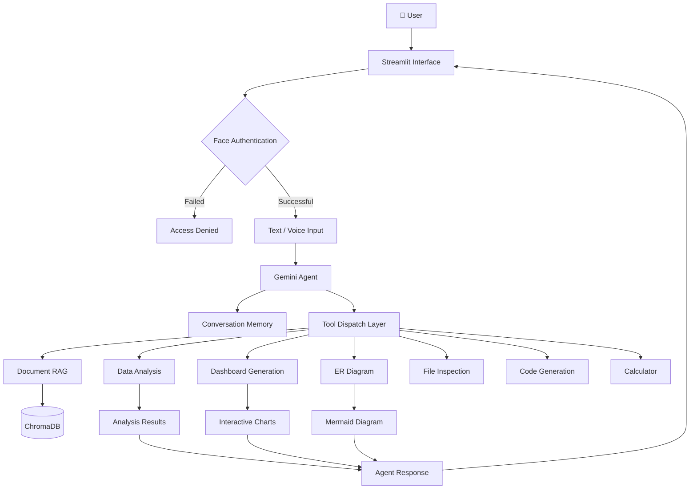
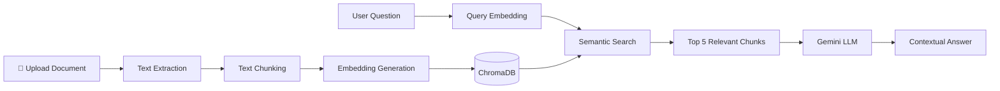
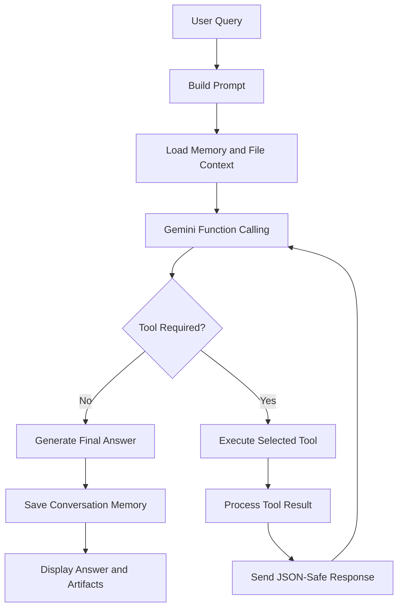

# 🤖 Multimodal AI Personal Assistant

### An Intelligent, Face-Authenticated Agentic AI System with Voice Interaction, Document RAG, and 9 LLM-Powered Tools

<p align="center">
  
  
  
  
  
  
</p>

<p align="center">
  <b>One AI assistant. Nine tools. Multiple capabilities. One conversational interface.</b>
</p>

---

## 📌 Project Overview

The **Multimodal AI Personal Assistant** is an intelligent, agent-based application designed to simplify everyday tasks involving document understanding, data analytics, visualization, and code generation.

Unlike traditional AI chatbots that only generate text responses, this assistant uses **Google Gemini Function Calling** to understand user requests, select appropriate tools, execute tasks, and generate contextual responses.

It also integrates face authentication and voice interaction to provide a more personalized and interactive experience.

### 🎯 Key Highlights

- 🔐 **Face Authentication:** Secure access using facial recognition.
- 🎤 **Voice Interaction:** Ask questions using voice input.
- 📚 **Document Intelligence:** Retrieve relevant information from uploaded documents using RAG.
- 📊 **Data Analytics:** Automatically profile CSV and Excel datasets.
- 📈 **Dashboard Generation:** Create interactive dashboards with KPIs and visualizations.
- 🗂️ **ER Diagram Generation:** Convert SQL schemas into Mermaid ER diagrams.
- 💻 **AI Code Generation:** Generate Python and SQL code from natural-language instructions.
- 🧠 **Conversation Memory:** Maintain conversational context across interactions.
- 🔄 **Agentic AI:** Dynamically select and execute tools based on user intent.

---

## 🏗️ System Architecture

The application follows a modular architecture where Streamlit manages the user interface, Gemini acts as the reasoning engine, and specialized Python modules perform individual tasks.



---

## ✨ Core Features

| Feature | Description | Technology |
|---|---|---|
| 🔐 Face Authentication | Recognizes registered users using facial encodings | dlib, OpenCV |
| 🎤 Voice Input | Converts spoken questions into text | SpeechRecognition |
| 📚 Document RAG | Searches uploaded documents semantically | ChromaDB |
| 📊 Dataset Profiling | Analyzes structure, missing values, duplicates and correlations | Pandas, NumPy |
| 📈 Auto Dashboard | Generates KPIs, interactive charts and insights | Plotly |
| 🗂️ ER Diagram | Converts SQL schemas into visual database diagrams | Mermaid |
| 💻 Code Generation | Generates Python and SQL from natural language | Gemini |
| 🧠 Memory | Maintains previous conversational exchanges | JSON |
| 🔄 Agentic Reasoning | Selects and executes tools dynamically | Gemini Function Calling |

---

## 🧰 The 9 AI Tools

The assistant uses function calling to identify the appropriate tool for each request.

| No. | Tool | Purpose |
|---|---|---|
| 1 | `calculator` | Performs mathematical calculations safely |
| 2 | `search_documents` | Retrieves relevant information from uploaded documents |
| 3 | `list_indexed_documents` | Displays indexed documents |
| 4 | `index_uploaded_documents` | Indexes documents into the vector database |
| 5 | `inspect_uploaded_file` | Inspects uploaded file structures |
| 6 | `analyze_uploaded_dataset` | Performs statistical dataset analysis |
| 7 | `generate_dashboard` | Generates interactive dashboards |
| 8 | `create_er_diagram` | Creates ER diagrams from SQL schemas |
| 9 | `generate_python / generate_sql` | Generates Python and SQL code |

**Note:** The ninth tool declaration supports two code-generation operations: Python and SQL.

---

## 📚 Retrieval-Augmented Generation (RAG)

The assistant uses RAG to retrieve relevant information from uploaded PDF, DOCX, TXT, and Markdown documents.

### RAG Workflow



### Implementation Details

- **Embedding Model:** all-MiniLM-L6-v2
- **Vector Database:** ChromaDB
- **Chunk Size:** 500 tokens
- **Chunk Overlap:** 100 tokens
- **Retrieval:** Top 5 relevant chunks
- **Duplicate Prevention:** SHA-256 content hashing

---

## 🔐 Face Authentication System

Security is implemented using facial recognition before accessing the main application.

### Authentication Workflow

1. Register users with facial images.
2. Detect faces using the face recognition pipeline.
3. Generate 128-dimensional facial encodings.
4. Store registered encodings.
5. Capture the user's face during login.
6. Compare facial encodings using Euclidean distance.
7. Grant access when the distance is below the configured threshold of 0.45.

**Important:** The current implementation does not include liveness detection, so it is not resistant to photo-based spoofing.

---

## 🧠 Agentic AI Workflow

The central component of the application is the Gemini-powered agent.

Instead of relying on predefined keyword routing, the LLM determines which tool should be executed based on the user's request and conversation context.



The execution loop is controlled by `MAX_TOOL_STEPS` to prevent unlimited tool execution.

---

## 🔬 Important Technical Decisions

### 1. Dual-Channel Tool Results

Complex Python objects such as Pandas DataFrames and Plotly figures cannot be directly passed through Gemini's JSON function-response format.

To solve this problem, the application separates the results into two channels:

- **LLM Channel:** JSON-safe summaries, KPI values and insights.
- **UI Channel:** Actual Plotly figures, diagrams and other rich objects.

This allows the LLM to interpret analytical results while Streamlit renders the visualizations.

### 2. Safe Calculator

The calculator uses Python AST parsing with an operator whitelist instead of `eval()` to reduce execution risks.

### 3. Content-Based Document Indexing

SHA-256 hashes are used to generate chunk IDs and prevent duplicate document chunks during repeated uploads.

### 4. Dynamic Tool Selection

Gemini Function Calling replaces basic keyword-based routing, allowing the assistant to select tools based on the meaning and context of a request.

---

## 🛠️ Technology Stack

| Category | Technologies |
|---|---|
| Programming Language | Python 3.11 |
| Frontend | Streamlit |
| LLM | Google Gemini API |
| Agent Framework | Gemini Function Calling |
| RAG | Retrieval-Augmented Generation |
| Embeddings | Sentence Transformers |
| Vector Database | ChromaDB |
| Face Recognition | dlib, face_recognition, OpenCV |
| Speech Processing | SpeechRecognition, pyttsx3 |
| Data Analysis | Pandas, NumPy |
| Data Visualization | Plotly Express |
| Diagram Generation | Mermaid |
| File Processing | PDF, DOCX, TXT, MD, CSV, Excel, SQL |

---

## 📂 Project Structure

```text
multimodal-ai-assistant/
│
├── app.py
├── agent.py
├── tools.py
├── rag.py
├── memory.py
├── llm.py
├── speech.py
├── face_agent.py
├── requirements.txt
├── .env
│
├── src/
│   ├── recognize_face.py
│   ├── register_face.py
│   ├── data_analysis.py
│   ├── dashboard.py
│   ├── er_diagram.py
│   ├── file_processor.py
│   ├── code_generator.py
│   └── multimodal.py
│
├── tests/
│   ├── test_agent.py
│   └── test_tools.py
│
├── docs/
│   └── screenshots/
│
└── data/
    ├── faces/
    ├── uploads/
    ├── chroma_db/
    └── memory.json
```

---

## 🚀 Installation and Setup

### Prerequisites

- Python 3.11
- Google Gemini API Key
- Webcam for facial authentication
- Internet connection for API access and speech recognition

### Step 1: Clone the Repository

```bash
git clone https://github.com/akhil2203031050881/multimodal-ai-assistant.git

cd multimodal-ai-assistant
```

### Step 2: Create a Virtual Environment

```bash
python -m venv .venv

.venv\Scripts\activate
```

### Step 3: Install Dependencies

```bash
pip install dlib-bin

pip install -r requirements.txt

pip install face_recognition --no-deps
```

### Step 4: Configure Environment Variables

Create a `.env` file in the root directory.

```env
GEMINI_API_KEY=your_gemini_api_key
GEMINI_MODEL=your_supported_gemini_model
```

### Step 5: Register Your Face

Add 5–10 clear facial images inside:

```text
data/faces/YourName/
```

Run:

```bash
python src/register_face.py
```

Test recognition:

```bash
python src/recognize_face.py
```

### Step 6: Run the Application

```bash
streamlit run app.py
```

---

## 💡 Example Use Cases

| User Request | Assistant Action |
|---|---|
| "Explain this contract" | Retrieves relevant document sections |
| "Analyze my sales.csv file" | Performs dataset profiling |
| "Create a dashboard" | Generates KPIs and interactive charts |
| "Generate an ER diagram" | Converts SQL schema into a Mermaid diagram |
| "Write Python code to remove duplicates" | Generates Python code |
| "Calculate 17 × 23" | Executes the safe calculator |
| "What documents are indexed?" | Lists indexed documents |

---

## ⚠️ Known Limitations

- Memory and document collections are currently shared across authenticated users.
- Face authentication does not include liveness detection.
- Concurrent sessions may overwrite conversation history.
- Speech recognition requires internet connectivity.
- Large datasets may consume significant system memory.
- English is the currently supported language.
- Generated Python and SQL code is returned as source code and is not automatically executed.

---

## 🗺️ Future Enhancements

- [ ] Per-user conversation memory and document isolation.
- [ ] Face liveness detection.
- [ ] Offline voice recognition using Whisper.
- [ ] User-level access management.
- [ ] Tool execution audit logs.
- [ ] Docker deployment.
- [ ] Improved multi-agent collaboration.
- [ ] Model performance comparison.

---

## 🔒 Security Considerations

- Store API keys in environment variables.
- Never commit `.env` files.
- Exclude biometric encodings from version control.
- Protect uploaded documents and conversation history.
- Treat face recognition as an access-control layer, not a complete security solution.

Recommended `.gitignore`:

```gitignore
.env
.venv/
encodings.pkl
data/uploads/
data/faces/
data/chroma_db/
data/memory.json
__pycache__/
*.pyc
```

---

## 👨‍💻 Author

**Akhil Reddy Sankati**

🎓 B.Tech – Computer Science and Engineering

💼 Areas of Interest: Data Science | Generative AI | Agentic AI | Machine Learning

🔗 **GitHub:** [AkhilReddySankati](https://github.com/AkhilReddySankati)

🔗 **LinkedIn:** [Akhil Reddy Sankati](https://www.linkedin.com/in/akhil-reddy-sankati-datascientist/)

📧 **Email:** akhilreddysankati1328@gmail.com

---

<p align="center">
  **Built with Python, Google Gemini, RAG and Agentic AI.**
  <br/>
  ⭐ If you find this project interesting, consider giving it a star!
</p>
 
